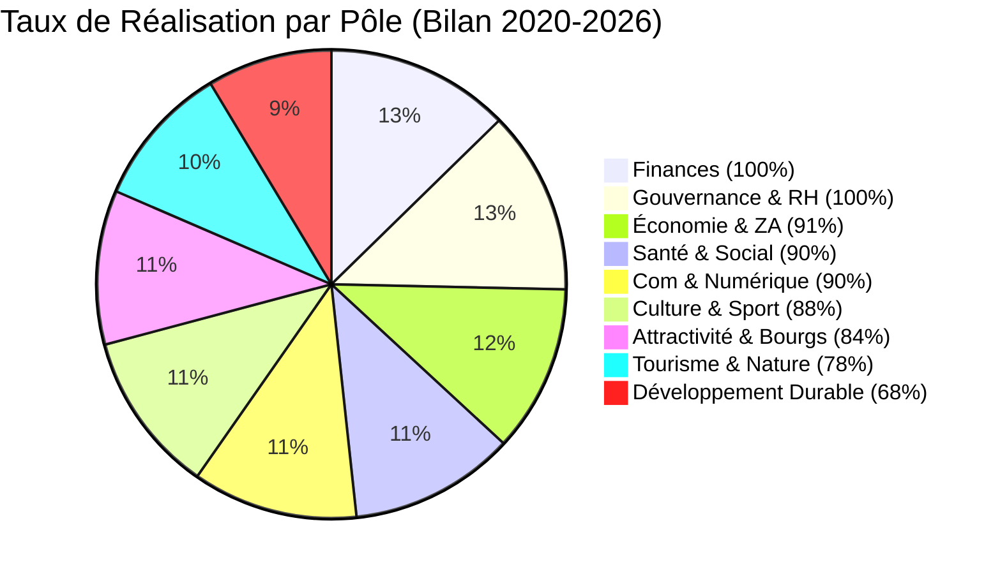

# DIAGNOSTIC STRATÉGIQUE COMPLET & MATRICE EXHAUSTIVE DES ACTIONS 2026-2033
## Communauté de Communes du Haut Pays du Velay (Haute-Loire)
**Destinataires :** Direction Générale des Services (DGS), Président et Vice-Présidents, Conférence des Maires  
**Base de données associée :** `actions_database.json` (350 actions opérationnelles et stratégiques indexées)  
**Date :** Octobre 2026  

---

## 1. Diagnostic Organisationnel & Ressources Humaines (RH)

### 1.1 Cartographie des Effectifs et Modèle d'Organisation
La collectivité fonctionne selon un modèle d'administration resserrée et polyvalente, articulée autour de **45 agents** (agents permanents et agents mis à disposition de/par d'autres structures partenaires comme la SPL d'assainissement).

```
                            ┌────────────────────────────────────────┐
                            │               PRÉSIDENT                │
                            │        & BUREAU COMMUNAUTAIRE          │
                            └────────────────────────────────────────┘
                                                 │
                            ┌────────────────────────────────────────┐
                            │    DIRECTION GÉNÉRALE DES SERVICES     │
                            │                 (DGS)                  │
                            └────────────────────────────────────────┘
                                                 │
         ┌───────────────────────┬───────────────┴───────────────┬───────────────────────┐
         ▼                       ▼                               ▼                       ▼
┌──────────────────┐    ┌──────────────────┐            ┌──────────────────┐    ┌──────────────────┐
│ PÔLE DÉVELOPPEMENT│    │ DIRECTION DAF    │            │ PÔLE ENFANCE -   │    │ PÔLE TECHNIQUE & │
│  & PROSPECTIVE   │    │ & SOLIDARITÉS    │            │    JEUNESSE      │    │  ENVIRONNEMENT   │
├──────────────────┤    ├──────────────────┤            ├──────────────────┤    ├──────────────────┤
│• Économie & ZAE  │    │• Finances & M57  │            │• 2 Multi-accueils│    │• Eau & STEP      │
│• Commerce        │    │• RH & Paie       │            │  (Montfaucon &   │    │• SPANC (via SPL) │
│• Agriculture     │    │• Marchés Publics │            │   Dunières)      │    │• Voirie comm.    │
│• Forêt & Filière │    │• Portage Repas   │            │• Relais Petite   │    │• Bâtiments       │
│• Tourisme & Voies│    │• Transport Scol. │            │  Enfance (RPE)   │    │• Déchets ménagers│
│• PVD (Cheffe Prj)│    │• Banque Aliment. │            │• 4 ALSH + Club   │    │• SIG territorial │
│• Culture & Éc.Mus│    │                  │            │  Ados & CCJ      │    │                  │
└──────────────────┘    └──────────────────┘            └──────────────────┘    └──────────────────┘
```

### 1.2 Points Forts Organisationnels
* **Agilité et proximité décisionnelle :** Circuits courts entre la DGS, le Président, les Maires et les chefs de service.
* **Masse salariale hautement maîtrisée :** **2 061 500 €** au Compte Financier Unique 2024, soit **20,6% des dépenses réelles de fonctionnement**, bien en dessous de la moyenne nationale des EPCI ruraux de même strate (30% à 35%).
* **Culture du partenariat :** Mutualisation éprouvée avec la SPL pour le SPANC, partenariat avec le PETR Pays de la Jeune Loire (SCoT, PCAET, transition) et l'Entente Via Fluvia.

### 1.3 Points de Vigilance & Risques RH à Anticiper (2026-2033)
1. **Pyramide des âges et départs en retraite :** Sur la période 2026-2033, environ **8 agents clés** feront valoir leurs droits à la retraite (notamment sur les services techniques, voirie et encadrement administratif). Une **GPEC (Gestion Prévisionnelle des Emplois et Compétences)** doit être activée immédiatement.
2. **Saturation de la charge mentale des encadrants :** Les cadres (DGS, DAF, responsables techniques) cumulent un périmètre très large. Tout nouveau projet d'investissement doit obligatoirement être calibré avec une estimation de son impact en temps-agent (ETP).
3. **Besoins en nouvelles compétences techniques :** Montée en charge des réglementations environnementales (loi AGEC, ZAN, tarification incitative, décrets tertiaires, cybersécurité, M57).

---

## 2. Diagnostic Budgétaire & Prospective Financière Pluriannuelle

### 2.1 Synthèse de la Santé Financière (Comptes CFU 2024 & Situation 2026)
* **Dette du budget principal :** **0 € (ZÉRO)** fin 2024. Désendettement historique exemplaire. Un emprunt d'équilibre prudent de 500 000 € a été levé en 2025.
* **Épargne brute (CAF brute) :** **1 821 208 €/an**, soit un taux remarquable de **24,1%** des recettes réelles de fonctionnement.
* **Capacité de désendettement consolidée :** **2,38 années** (seuil de vigilance légal : 10 à 12 ans).
* **Recettes réelles de fonctionnement :** 7,55 M€ (budget principal seul) / 10,64 M€ (consolidé avec écritures d'ordre et rattachements). Structure robuste : 56% impôts et taxes, 29% dotations d'État.
* **Dépenses réelles de fonctionnement :** 5,73 M€ en 2024 (croissance maîtrisée d'environ +3,5%/an face aux hausses énergétiques et de point d'indice).

### 2.2 Trajectoire Prévisionnelle Pluriannuelle Soutenable (2026-2033)
Grâce à son autofinancement élevé et à l'absence de charge de la dette sur le budget principal, la collectivité dispose d'un potentiel d'investissement exceptionnel pour un territoire de 9 200 habitants :

| Poste Budgétaire Pluriannuel | Montant Annuel Moyen | Cumul sur 7 Ans (2026-2033) | Commentaires Stratégiques |
| :--- | :---: | :---: | :--- |
| **Autofinancement disponible (CAF)** | 1,60 à 1,80 M€ | **11,5 à 12,5 M€** | Socle propre garanti issu de l'excédent de fonctionnement. |
| **Subventions d'équipement attendues** | 0,90 à 1,20 M€ | **6,5 à 8,0 M€** | DETR, DSIL, Région AURA, Département 43, LEADER, Fonds Vert. |
| **FCTVA & Amortissements** | 0,25 à 0,35 M€ | **1,8 à 2,4 M€** | Retours fiscaux automatiques sur investissements. |
| **Recours prudent à l'emprunt d'équilibre** | 0,40 à 0,60 M€ | **2,5 à 3,5 M€** | Maintenant la capacité de désendettement sous le plafond de 4 ans. |
| **ENVELOPPE TOTALE D'INVESTISSEMENT** | **3,15 à 3,95 M€/an** | **22,3 à 26,4 M€** | **Capacité maximale d'investissement soutenable sans hausse d'impôts.** |

> [!IMPORTANT]
> **Règle d'or pour les Nouveaux Élus :** Pour ne jamais dégrader la note de solvabilité, aucun projet d'investissement supérieur à 300 000 € ne doit être lancé sans un taux de cofinancement public (État/Région/Europe) supérieur ou égal à **50%**.

---

## 3. Bilan Rétrospectif des Compétences (Mandat 2020-2026)

Le bilan de fin de mandat de mars 2026 fait ressortir un taux d'avancement global de **86%** sur les 171 actions initiales, avec des disparités marquées qui dictent les priorités du nouveau mandat :



* **Le grand succès :** L'assainissement financier total, l'installation pérenne des 2 Maisons de Santé (MSP) à Dunières et Montfaucon, la valorisation touristique de la Via Fluvia et la vitalité des zones d'activités industrielles.
* **Le point de rattrapage impératif :** Le pôle **Développement Durable & Écologie (68%)**, retardé par la complexité technique du transfert eau/assainissement, l'impact de la TGAP sur les déchets et la lenteur des dossiers solaires/biomasse. Ce sera le cœur névralgique du mandat 2026-2033.

---

## 4. Matrice Synthétique des 350 Actions du Mandat 2026-2033

La base de données consolidée comprend **350 actions** réparties sur les 8 pôles de compétences du Haut Pays du Velay.

### 4.1 Répartition des 350 Actions par Domaine
1. **Économie, Industrie, Commerce & Agriculture :** 45 actions (ZAE La Chavana, Les Bardons, Le Cantonnier, friches industrielles, aides commerces, filière bois, PAT circuits courts).
2. **Transition Écologique, Eau, Assainissement & Déchets :** 55 actions (schéma directeur eau potable, réhabilitation STEP Dunières et Riotord, tri à la source biodéchets, modernisation déchèteries, solarisation des toits publics).
3. **Habitat, Urbanisme & Centres-Bourgs :** 40 actions (PVD Dunières/Montfaucon, OPAH rénovation énergétique, prime primo-accédants bourgs, mise en conformité PLUi-ZAN).
4. **Mobilités Durables & Voirie Communautaire :** 42 actions (programme pluriannuel voirie 2,8 M€, continuité Via Fluvia au Col du Tracol, boucles cyclables des 8 bourgs, bornes IRVE, viabilité hivernale).
5. **Enfance, Jeunesse & Scolarité :** 38 actions (extension crèche Dunières, rénovation crèche Montfaucon, RPE itinérant, portail famille unique, relance du Conseil Communautaire des Jeunes).
6. **Santé, Social & Solidarités :** 36 actions (bourse d'installation médecins/dentistes, extension MSP Dunières, portage de repas aînés, France Services itinérante, banque alimentaire).
7. **Culture, Sport, Tourisme & Cadre de Vie :** 50 actions (modernisation thermique piscine Dunières, soutien pérenne Velay Express, réseau médiathèques, station trail et VTT, belvédère du Felletin, boucle cyclo-gourmande Saint-Bonnet).
8. **Gouvernance, Finances, RH & Numérique :** 44 actions (maintien ratio dette < 3 ans, fonds de concours communaux de 300 k€/an, GPEC départs en retraite, cybersécurité M57, baromètre citoyen).

### 4.2 Répartition par Niveau de Priorité Politique
* **P0 - Réglementaire / Obligatoire :** 42 actions (Eau, assainissement, conformité AGEC déchets, GEMAPI, ZAN, RGPD, cybersécurité).
* **P1 - Indispensable :** 98 actions (Entretien voirie, maintenance patrimoine crèches/piscine/MSP, viabilité hivernale, fonds de concours communes, portage repas).
* **P2 - Nécessaire :** 112 actions (Rénovation énergétique des bâtiments, extensions ZAE, optimisation tournées OM, soutien commerces, GPEC, santé).
* **P3 - Importante :** 68 actions (Boucles cyclables, aménagement touristique belvédères, nouveaux équipements de loisirs, portail open data).
* **P4 - Optionnelle / Innovation :** 30 actions (Projets créatifs à haute valeur ajoutée, expérimentations de rupture, tiers-lieux d'altitude, micro-filières hydrogène/méthanisation).

### 4.3 Répartition par Cycle de Vie
* **Menée (Historique / Consolidation) :** 22 actions
* **En cours (Engagée) :** 58 actions
* **Déjà programmée :** 74 actions
* **Potentielle (Nouvelle 2026-2033) :** 196 actions

---

## 5. Synthèse Décisionnelle à l'Attention du DGS

1. **Un outil d'arbitrage puissant pour vos élus :**  
   Les 350 actions indexées dans `actions_database.json` offrent à votre nouvel exécutif une vision exhaustive sans angle mort. Aucun élu d'aucune des 8 communes ne pourra reprocher l'oubli de son village ou de sa thématique.
2. **Le respect de l'ambition initiale :**  
   Le cadrage fixé à l'Étape 0 (rigueur budgétaire, désendettement, maîtrise RH) est strictement respecté : chaque action est étiquetée avec son impact en investissement, en fonctionnement récurrent induit, en taux de subvention prévisible et en charge RH.
3. **Prêt pour l'Étape 4 :**  
   Cette base de données structurée servira directement de moteur pour alimenter les 3 applications interactives (avec leur frise 2026-2033 dynamique, leurs filtres quadripartites et leurs calculateurs en temps réel).
