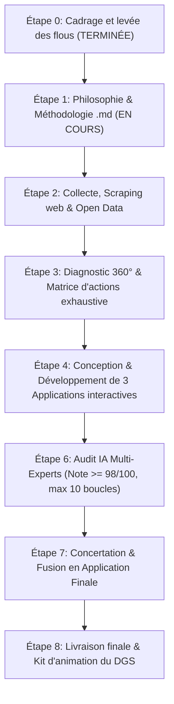

# PHILOSOPHIE ET MÉTHODOLOGIE DU PLAN DE MANDAT 2026-2033
## Communauté de Communes du Haut Pays du Velay (Haute-Loire)
**À l'attention de :** Direction Générale des Services (DGS) & Exécutif Communautaire  
**Horizon temporel :** 2026 – 2033 (7 exercices budgétaires complets)  
**Document de cadrage méthodologique de référence**

---

## 1. Contexte & Enjeux Stratégiques

### 1.1 Le Défi de l'Installation du Nouvel Exécutif
À l'issue des élections municipales et communautaires de 2026, la Communauté de Communes du Haut Pays du Velay accueille un nouvel exécutif et un Conseil communautaire renouvelé. Pour un Directeur Général des Services (DGS), ce moment charnière présente une double exigence :
1. **Pédagogique et fédératrice :** Aider des élus aux profils et sensibilités variés à appréhender la complexité des compétences intercommunales, les équilibres territoriaux entre les communes membres, et la réalité des contraintes légales.
2. **Gestionnaire et prospective :** Transformer des aspirations politiques et des promesses électorales en une **Programmation Pluriannuelle des Investissements (PPI)** et une trajectoire de fonctionnement soutenables, réalistes et mesurables.

### 1.2 Le Cadre Territorial du Haut Pays du Velay
Territoire rural de moyenne montagne en Haute-Loire, le Haut Pays du Velay se caractérise par :
* Un maillage de bourgs-centres et de communes rurales nécessitant une solidarité intercommunale étroite.
* Une vocation économique marquée (industrie, artisanat, agroalimentaire, sylviculture, gastronomie réputée).
* Des enjeux cruciaux de services au public (santé, petite enfance, mobilité en milieu dispersé, maintien des commerces).
* La gestion de compétences techniques lourdes (déchets ménagers, eau et assainissement, voirie communautaire, zones d'activités).

### 1.3 La Ligne Directrice : Rigueur, Désendettement et Efficience RH
Conformément aux orientations fixées lors du cadrage initial (Étape 0), ce plan de mandat repose sur un impératif cardinal :
* **La maîtrise stricte des équilibres financiers :** Préservation de l'épargne brute (Capacité d'Autofinancement - CAF brute), maintien d'une capacité de désendettement saine (< 6 à 8 années maximum), et refus de la dérive de la fiscalité locale.
* **L'optimisation des Ressources Humaines :** Rationalisation de la masse salariale (chapitre 012), renforcement des compétences internes, mutualisations intelligentes avec les communes membres et adéquation stricte entre les projets politiques et la charge de travail des agents.

---

## 2. Philosophie du Plan de Mandat : Les 4 Piliers Fondateurs

```
               ┌────────────────────────────────────────────────────────┐
               │    PLAN DE MANDAT 2026-2033 : LES 4 PILIERS DU DGS     │
               └────────────────────────────────────────────────────────┘
                                           │
         ┌──────────────────┬──────────────┴─────┬──────────────────┐
         ▼                  ▼                    ▼                  ▼
┌──────────────────┐┌──────────────────┐┌──────────────────┐┌──────────────────┐
│   PILIER 1       ││   PILIER 2       ││   PILIER 3       ││   PILIER 4       │
│ Responsabilité   ││ Multidiscipline  ││ Dynamisme &      ││ Double Moteur    │
│ & Trajectoire    ││ & Transparence   ││ Interactivité    ││ Continuité       │
│ Financière       ││ Multi-Acteurs    ││ Temporelle       ││ & Rupture        │
└──────────────────┘└──────────────────┘└──────────────────┘└──────────────────┘
```

### Pilier 1 : La Responsabilité Budgétaire comme Prérequis à l'Action
Un projet non financé ou surdimensionné fragilise durablement la collectivité. La philosophie retenue impose que **chaque action proposée soit assortie :**
* D'une estimation de son coût d'investissement (CAPEX) et des subventions prévisionnelles mobilisables (DETR, DSIL, Région AURA, Département 43, Europe LEADER, Agence de l'Eau, Fonds Vert).
* De son coût récurrent de fonctionnement induit (OPEX) : maintenance, énergie, fluides.
* De son impact en Équivalents Temps Plein (ETP) pour les services techniques et administratifs.

### Pilier 2 : La Transparence et l'Accessibilité Quadripartite
Le plan de mandat ne doit pas rester un document bureaucratique enfoui dans un tiroir. L'outil conçu sera accessible et décliné sous **4 prismes de lecture instantanés** :
1. **Vue "Élus & Gouvernance" :** Vision politique claire, arbitrage par priorité, impacts sur les communes, calendrier de réalisation, aide à la prise de décision.
2. **Vue "Citoyens & Habitants" :** Clarté du service rendu au quotidien, amélioration du cadre de vie, visibilité des réalisations concrètes sur leur commune, justification de l'usage de l'impôt.
3. **Vue "Contrôle de Gestion & Finances" :** Ratios de solvabilité, profil de la dette, trajectoire de CAF nette, prospective budgétaire M57, impact annuel sur les ratios de dépenses réelles de fonctionnement.
4. **Vue "Ressources Humaines & Organisation" :** Charge de travail des pôles, compétences requises, plan de formation, prévision des recrutements versus redéploiements internes.

### Pilier 3 : La Flexibilité Interactive et Temporelle (Frise 2026-2033)
Le mandat est une matière vivante soumise aux aléas économiques, réglementaires et climatiques. L'outil interactif intégrera une frise chronologique dynamique permettant aux élus de :
* Déplacer une action dans le temps (ex: décaler un chantier d'un an en cas de baisse de dotation).
* Observer instantanément la recalculation du plan de financement et l'étalement de la charge RH.
* Ajouter, supprimer ou modifier des actions à n'importe quel moment du mandat (2026-2033).

### Pilier 4 : Le Double Moteur « Rigueur de Base » & « Température Créative de Rupture »
Pour éviter le piège de la reconduction mécanique du passé tout en garantissant la sécurité de gestion, la démarche s'appuie sur la génération de **3 applications complètes** :
* **Version 1 (Maîtrise & Réalisme) :** Socle pragmatique axé sur l'optimisation des compétences actuelles, la rationalisation des coûts et le désendettement.
* **Versions 2 & 3 (Haute Température / Innovation de Rupture) :** Exploration de propositions audacieuses (nouveaux modèles de mutualisation intercommunale, tiers-lieux économiques, valorisation locale des énergies renouvelables et de la filière bois, innovations de mobilité solidaire, nouveaux partenariats publics-privés).
* **Fusion finale (Étape 7) :** Sélection concertée des meilleures innovations intégrées dans le cadre financier sécurisé.

---

## 3. Typologie et Matrice de Priorisation des Actions

Chaque action inscrite au plan de mandat est qualifiée selon deux axes normalisés :

### 3.1 Niveau de Priorité Politique et Réglementaire
1. **Obligatoire / Réglementaire (P0) :** Obligation légale, conformité sanitaire/sécurité, transfert de compétence obligatoire (ex: GEMAPI, Schémas directeurs, RGPD, accessibilité ERP, conformité assainissement).
2. **Indispensable (P1) :** Maintien en état du patrimoine communautaire existant, continuité essentielle du service public (remplacement de matériels critiques, réfection des réseaux prioritaires, sécurité incendie).
3. **Nécessaire (P2) :** Amélioration significative de l'efficience d'un service existant, réduction des coûts de fonctionnement à moyen terme (rénovation thermique, dématérialisation, optimisation des tournées de collecte).
4. **Important (P3) :** Nouveau service ou équipement répondant à une attente forte des habitants ou renforçant l'attractivité économique du Haut Pays du Velay.
5. **Optionnel / Innovation (P4) :** Projet opportuniste conditionné à un taux de subvention exceptionnel (> 70-80%) ou à l'émergence d'un partenaire extérieur.

### 3.2 Cycle de Vie de l'Action
* **Menée (Historique / REX) :** Action achevée récemment, servant de point de repère budgétaire et opérationnel.
* **En cours (Actuelle) :** Projet engagé (engagements comptables pris ou travaux débutés).
* **Déjà programmée :** Validée par délibération antérieure ou inscrite au budget en cours, à planifier précisément.
* **Potentielle / Nouvelle :** Piste d'action issue du diagnostic ou des ateliers d'innovation, à arbitrer par les élus.

---

## 4. Déroulement Méthodologique Complet (Feuille de Route)



### Étape 0 : Cadrage Stratégique *(Validée)*
* Alignement avec le DGS sur les priorités : Rigueur budgétaire, désendettement, maîtrise des charges RH.
* Choix de l'horizon : 2026-2033 (7 exercices budgétaires complets).
* Définition du protocole de créativité à température différenciée.

### Étape 1 : Charte Philosophique et Méthodologique *(Le présent livrable)*
* Formalisation de la doctrine, des règles d'arbitrage et du mode opératoire.

### Étape 2 : Récolte Exhaustive des Données & Scraping Territorial
* **Scraping ciblé du site officiel :** [https://hautpaysduvelay-communaute.fr/](https://hautpaysduvelay-communaute.fr/) (compétences, statuts, composition des commissions, délibérations, bulletins intercommunaux, marchés publics, actualités de projets).
* **Collecte des données financières et socio-démographiques ouvertes :**
  * Comptes de gestion DGCL / OFGL de la CC Haut Pays du Velay (dépenses réelles de fonctionnement, épargne nette, encours de dette, capacité de désendettement).
  * Données INSEE (démographie, soldes migratoires, pyramide des âges, emploi local, fiscalité des ménages).

### Étape 3 : Diagnostic Complet & Matrice Exhaustive des Actions
* Diagnostic organisationnel (organigramme fonctionnel, ressources internes).
* Diagnostic budgétaire (marges d'autofinancement, fiscalité, dette).
* Constitution d'un catalogue exhaustif d'actions classées par pôle de compétences :
  * Économie, Tourisme & Commerce.
  * Environnement, Eau, Assainissement & Déchets.
  * Aménagement du territoire, Urbanisme & Habitat.
  * Services aux familles, Petite Enfance, Santé & Social.
  * Mobilités, Voirie & Espaces publics communautaires.
  * Administration générale, Finances, RH & Moyens généraux.

### Étape 4 : Développement des 3 Applications Interactives
* **Architecture technique autonome :** HTML5, CSS moderne (Tailwind-like fluide, accessible, mode responsive) et JavaScript ES6 modulaire, exécutable directement en double-cliquant sur `index.html` (sans serveur Node.js obligatoire).
* **Fonctionnalités clés :**
  * Tableau de bord synthétique du diagnostic.
  * Frise chronologique interactive (2026-2033) avec ajout/suppression/glissement dynamique d'actions.
  * Calculateur instantané d'impacts budgétaires (Investissement, Subventions, Fonctionnement récurrent) et RH.
  * Filtre 4 vues : Élus, Citoyens, Finances, RH.
  * Exportation des scénarios validés.
* **Production des 3 déclinaisons :**
  * `App_V1_Base_Rigueur.html` : Rigueur de gestion, consolidation et ratios stricts.
  * `App_V2_Innovation_Rupture_A.html` : Température haute (projets d'attractivité territoriale et transition d'avant-garde).
  * `App_V3_Innovation_Rupture_B.html` : Température haute (mutualisation citoyenne avancée et nouveaux services).

### Étape 6 : Protocole d'Évaluation & d'Amélioration Continue par IA Spécialisées
Chaque version applicative est soumise à un jury de 4 IA expertes indépendantes disposant d'un protocole strict :
1. **L'Architecte Frontend / UI-UX Designer :** Évalue la lisibilité, l'esthétique, la réactivité, l'ergonomie de la frise chronologique, la conformité graphique et la gestion des contrastes (sur la base du code et de captures d'écran).
2. **L'Élu Communautaire Référent :** Évalue l'utilité politique, la facilité d'arbitrage, l'équilibre territorial entre communes, la crédibilité des délais de mise en œuvre.
3. **Le Citoyen Résident du Haut Pays du Velay :** Évalue la clarté pédagogique (absence de jargon incompréhensible), la pertinence pour sa vie quotidienne et la transparence de l'action publique.
4. **Le Contrôleur de Gestion & Directeur Financier :** Évalue la rigueur des calculs, la cohérence des montants, la faisabilité des taux de subvention et le respect des ratios de désendettement.

**Règle d'or de la note d'audit :**
* Base : **100/100 points**.
* Chaque critique, maladresse visuelle, flou textuel ou incohérence financière retire **1 point**.
* Seuil d'admissibilité pour passer au profil suivant : **>= 98/100**.
* Plafond de sécurité anti-boucle : **10 itérations ciblées maximum** par évaluateur.
* Tenue d'un **registre d'audit** consignant chaque point de frottement et sa résolution technique.

### Étape 7 : Concertation, Synthèse et Fusion Finale
* Analyse comparative des 3 prototypes et de leurs retours d'audit.
* Fusion dans une **Application Finale d'Excellence** combinant l'ossature budgétaire ultra-rigoureuse de la V1 et les meilleures pépites d'innovation des V2 et V3.
* Nouveau passage de l'application finale dans le sas d'évaluation multi-experts (>= 98/100).

### Étape 8 : Livraison Clé en Main & Outils d'Accompagnement du DGS
* Remise de l'application finale (`index.html` + ressources).
* Fiche de synthèse exécutive pour la présentation en Conférence des Maires et en séminaire d'installation des élus.
* Guide méthodologique d'animation d'atelier pour le DGS.

---

## 5. Règle d'Engagement pour le DGS
Ce document constitue le contrat méthodologique garantissant au DGS un livrable irréprochable, conforme aux standards des finances publiques territoriales françaises, stimulant pour ses élus, et directement opérationnel sur le terrain.
